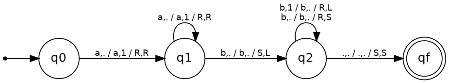
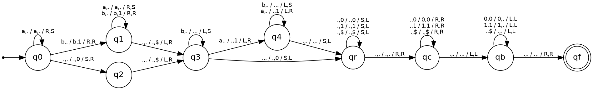

# Práctica 2: Simulador de Máquinas de Turing deterministas multicinta

Asignatura: Complejidad Computacional (ULL), curso 2026/27.

Simulador en C++17 de una Máquina de Turing (MT) determinista con un número arbitrario de cintas, más el diseño de dos MT concretas que se ejecutan con él.

## Índice

1. [Compilación y uso](#1-compilación-y-uso)
2. [Opciones de diseño elegidas](#2-opciones-de-diseño-elegidas)
3. [Formato del fichero de configuración](#3-formato-del-fichero-de-configuración)
4. [Salida del programa](#4-salida-del-programa)
5. [Manejo de errores](#5-manejo-de-errores)
6. [Estructura del proyecto](#6-estructura-del-proyecto)
7. [Diseño de clases](#7-diseño-de-clases)
8. [Máquinas de Turing diseñadas](#8-máquinas-de-turing-diseñadas)
9. [Tests](#9-tests)

---

## 1. Compilación y uso

Requisitos: `g++` con soporte de C++17 y `make`.

```bash
make            # genera build/main
make clean      # borra build/
```

Ejecución:

```bash
build/main -config <fichero_mt> [-in <fichero_cadenas>]
```

| Opción | Obligatoria | Descripción |
|---|---|---|
| `-config <f>` | Sí | Fichero con la definición de la MT. |
| `-in <f>` | No | Fichero con las cadenas de entrada, una por línea (una línea vacía es la cadena vacía). Si se omite, las cadenas se leen por teclado (se termina con `Ctrl+D`). |

Ejemplos:

```bash
build/main -config data/M1.txt -in data/M1_entradas.txt
build/main -config data/M2.txt                      # cadenas por teclado
```

---

## 2. Opciones de diseño elegidas

El enunciado deja varias variantes de la MT a elección del alumno. Estas son las elegidas:

| Aspecto | Opción elegida | Motivo |
|---|---|---|
| Escritura y movimiento | **Simultáneos**: en cada paso se escribe en cada cinta y se mueve su cabeza. | Permite diseñar las máquinas con menos transiciones. |
| Movimientos | **L, R y S** (izquierda, derecha, quieto). | Poder quedarse quieto simplifica mucho las máquinas multicinta. |
| Cinta | **Infinita por ambos lados.** | Es el modelo teórico habitual. |
| Límite de pasos | **Ninguno.** | Una MT puede no detenerse; es una propiedad de la máquina, no del simulador. |
| Aceptación | La MT **acepta si se detiene en un estado de F**. Se detiene cuando no hay transición aplicable. | Criterio por estado final. |
| Determinismo | Se verifica al cargar la máquina. | Dos transiciones con el mismo origen y las mismas lecturas son un error. |

### Cinta infinita en ambas direcciones

Cada cinta es un `std::vector<char>` más la posición de la cabeza:

* La cadena de entrada se coloca a partir de la **posición 1**; la posición 0 se deja con un blanco.
* La cabeza empieza en la **posición 1**, sobre el primer símbolo de la entrada (o sobre un blanco si la entrada es vacía).
* Al moverse a la derecha por encima del último elemento se añade un blanco al final.
* Al moverse a la izquierda desde la posición 0 se **inserta un blanco al principio** del vector (la cabeza se queda en la posición 0, que pasa a ser la nueva celda).

Así la cinta crece bajo demanda en ambos sentidos sin complicar el resto del código.

---

## 3. Formato del fichero de configuración

Las líneas vacías y todo lo que sigue a un `#` (comentario) se ignoran. Por esta razón, **`#` no puede usarse como símbolo**. Los símbolos son de un único carácter, y el punto (`.`) es un símbolo normal (en los ejemplos se usa como blanco).

Orden de las líneas:

| Línea | Contenido |
|---|---|
| 1 | Conjunto de estados Q, separados por espacios. |
| 2 | Alfabeto de entrada Σ. |
| 3 | Alfabeto de cinta Γ (incluye el blanco). |
| 4 | Estado inicial s. |
| 5 | Símbolo blanco b. |
| 6 | Conjunto de estados finales F. |
| 7 | Número de cintas N (≥ 1). |
| 8... | Una transición por línea. |

Formato de una transición con N cintas (2 + 3N campos):

```
origen lec_1 ... lec_N destino esc_1 ... esc_N mov_1 ... mov_N
```

Es decir: estado origen, el símbolo leído en cada cinta, estado destino, el símbolo escrito en cada cinta y el movimiento (`L`, `R` o `S`) de cada cinta. Ejemplo, con 2 cintas:

```
q0 a . q0 a a R R     # en q0 lee 'a' (cinta 1) y blanco (cinta 2); escribe a en ambas y mueve las dos a la derecha
```

Se comprueba al cargar la máquina que:

* Q no es vacío y el número de cintas es ≥ 1.
* El estado inicial pertenece a Q y los finales son un subconjunto de Q.
* El blanco pertenece a Γ y no pertenece a Σ; además Σ ⊆ Γ.
* Cada transición tiene exactamente 2 + 3N campos, sus estados pertenecen a Q, sus símbolos a Γ y sus movimientos son L, R o S.
* La máquina es determinista.

---

## 4. Salida del programa

Para cada cadena de entrada se muestra:

* La cadena.
* Si la MT la **acepta** (se detiene en un estado de F) o no, junto con el estado en el que se detuvo.
* El **contenido de cada cinta**, con la posición de la cabeza entre corchetes. Se recortan los blancos de los extremos, salvo la celda de la cabeza.

Ejemplo (MT 2):

```
Entrada: "abbabaabb"
Resultado: ACEPTADA (estado final: qf)
Cinta 1: [1]1111.1111
Cinta 2: [.]
```

Si una cadena contiene un símbolo que no está en Σ, se informa del error por `stderr` y **se continúa con la siguiente cadena** (no es un error fatal).

---

## 5. Manejo de errores

Todas las excepciones derivan de `ErrorAutomata` (fichero `include/errores.h`) y se capturan de forma centralizada en `main`:

| Excepción | Cuándo se lanza |
|---|---|
| `ErrorArgumentos` | Falta `-config`, falta el valor de una opción u opción desconocida. |
| `ErrorFichero` | Un fichero no existe o no se puede abrir. |
| `ErrorFormato` | Línea mal formada: símbolo de más de un carácter, nº de campos incorrecto, movimiento no válido, nº de cintas no numérico... |
| `ErrorValidacion` | La máquina no cumple la definición formal (estados o símbolos fuera de sus conjuntos, no determinismo...). |
| `ErrorEntrada` | Una cadena de entrada contiene símbolos que no están en Σ (no es fatal). |

Códigos de salida: `0` correcto, `1` error controlado, `2` error inesperado.

---

## 6. Estructura del proyecto

```
CC_Practica2/
├── Makefile
├── README.md
├── include/          # cabeceras (.h)
├── src/              # implementación (.cc) y main.cc
├── data/             # MT y cadenas de prueba
│   ├── M1.txt            # MT 1: a^n b^m, m >= n, n > 0
│   ├── M1_entradas.txt   # cadenas de prueba de la MT 1
│   ├── M2.txt            # MT 2: cuenta de b y a en unario
│   ├── M2_entradas.txt   # cadenas de prueba de la MT 2
│   ├── Ejemplo1.txt      # MT de ejemplo
│   └── Ejemplo2.txt      # MT de ejemplo
├── docs/             # grafos de las MT
│   ├── M1.png / M1.dot
│   └── M2.png / M2.dot
├── test/
│   └── test.sh       # batería de pruebas automáticas
└── build/            # generado por make
```

| Fichero | Ruta |
|---|---|
| MT 1 (configuración) | `data/M1.txt` |
| MT 1 (grafo) | `docs/M1.png` |
| MT 2 (configuración) | `data/M2.txt` |
| MT 2 (grafo) | `docs/M2.png` |

---

## 7. Diseño de clases

| Clase | Ficheros | Responsabilidad |
|---|---|---|
| `Movimiento` | `movimiento.h/.cc` | Enumerado `L`/`R`/`S` y conversiones desde/hacia carácter. |
| `Transicion` | `transicion.h` | Estructura con id, origen, lecturas, destino, escrituras y movimientos (uno por cinta). |
| `Transiciones` | `transiciones.h/.cc` | Conjunto de transiciones; busca la transición aplicable a un estado y unas lecturas. |
| `Alfabeto` | `alfabeto.h/.cc` | Conjunto de símbolos sin duplicados (vector). |
| `Cinta` | `cinta.h/.cc` | Una cinta infinita por ambos lados: leer, escribir, mover, y representación con la cabeza entre corchetes. |
| `MaquinaTuring` | `maquinaturing.h/.cc` | Definición formal de la MT (Q, Σ, Γ, s, b, F, nº de cintas, transiciones) y su validación al construirse. |
| `LectorMaquina` | `lectormaquina.h/.cc` | Lee y analiza el fichero de configuración. |
| `LectorCadenas` | `lectorcadenas.h/.cc` | Lee las cadenas de entrada de un fichero o del teclado. |
| `Simulador` | `simulador.h/.cc` | Ejecuta la MT sobre una cadena: lee, busca transición, escribe y mueve en todas las cintas, cambia de estado, hasta que no hay transición. |
| `ArgParser` | `argparser.h/.cc` | Interpreta la línea de comandos. |
| Errores | `errores.h` | Jerarquía de excepciones. |

Ciclo de ejecución del simulador, para una cadena:

1. Se comprueba que todos los símbolos de la entrada pertenecen a Σ.
2. Se crean las cintas (la primera con la entrada, el resto vacías) y se parte del estado inicial.
3. Mientras exista una transición aplicable al estado actual y a los símbolos bajo las cabezas: se escribe y se mueve en cada cinta, y se cambia de estado.
4. Cuando no hay transición, la máquina se detiene: acepta si el estado actual pertenece a F.

---

## 8. Máquinas de Turing diseñadas

En los grafos, cada arista lleva etiquetas `lectura_1,...,lectura_N / escritura_1,...,escritura_N / mov_1,...,mov_N`. El estado inicial se marca con una flecha de entrada y el final con doble círculo.

### 8.1. MT 1: L = { aⁿbᵐ | m ≥ n, n > 0 }

**Ficheros:** `data/M1.txt` (configuración), `docs/M1.png` (grafo, fuente en `docs/M1.dot`).



Acepta las cadenas formadas por n letras `a` seguidas de m letras `b`, con n > 0 y m ≥ n. Usa **2 cintas** (la cinta 2 hace de contador), **4 estados** y **6 transiciones**.

| Estado | Lee (cinta 1, cinta 2) | Acción | Destino |
|---|---|---|---|
| q0 | `a`, `.` | Escribe `1` en la cinta 2; las dos cabezas a la derecha | q1 |
| q1 | `a`, `.` | Igual que la anterior (cuenta las `a`) | q1 |
| q1 | `b`, `.` | Primera `b`: la cinta 2 retrocede a la última marca | q2 |
| q2 | `b`, `1` | Borra una marca por cada `b`; cinta 1 a la derecha, cinta 2 a la izquierda | q2 |
| q2 | `b`, `.` | Marcas agotadas: sobran `b` (permitido por m ≥ n) | q2 |
| q2 | `.`, `.` | Fin de la cadena sin marcas pendientes | qf |

Por qué rechaza lo que debe:

* Si la cadena no empieza por `a` (vacía, `b...`), q0 no tiene transición: se cumple n > 0.
* Si hay más `a` que `b`, al llegar al blanco de la cinta 1 queda un `1` en la cinta 2 y q2 no tiene transición para (`.`, `1`).
* Si aparece una `a` después de las `b`, q2 no tiene transición para `a`.

La cabeza de la cinta 2 está siempre sobre la última marca que queda, o sobre un blanco si ya no queda ninguna; por eso basta mirar si lee `1` o blanco.

### 8.2. MT 2: contar `b` y `a` en unario

**Ficheros:** `data/M2.txt` (configuración), `docs/M2.png` (grafo, fuente en `docs/M2.dot`).



Recibe una cadena de `a` y `b` y deja en la cinta 1 el número de `b` seguido del número de `a`, en unario y separados por un blanco (`0` si falta alguno), con la cabeza al principio del resultado. Ejemplos: `abbabaabb` → `11111·1111`, `aa` → `0·11`, `bb` → `11·0`.

Usa **2 cintas** (la cinta 2 es auxiliar), **9 estados** y **21 transiciones**. El símbolo `$` es un separador provisional en la cinta 2 (no puede ser un blanco, porque no se distinguiría del borde de la cinta).

| Fase | Estados | Descripción |
|---|---|---|
| Contar `b` (hacia la derecha) | q0, q1, q2 | Por cada `b` de la cinta 1 se escribe un `1` en la cinta 2. q0 = «aún no se ha visto ninguna `b`»; si se llega al final sin ver ninguna, q2 escribe `0`. Al final se escribe `$`. |
| Contar `a` (hacia la izquierda) | q3, q4 | Se vuelve por la cinta 1 borrándola; por cada `a` se escribe un `1`. q3 = «aún no se ha visto ninguna `a`»; si se llega al borde sin ver ninguna, se escribe `0`. |
| Rebobinar la cinta 2 | qr | Solo se mueve la cinta 2, hasta el blanco de su izquierda. |
| Copiar a la cinta 1 | qc | Se copia el resultado de la cinta 2 a la cinta 1 (`$` pasa a blanco). |
| Volver al inicio | qb, qf | Las dos cintas retroceden a la vez, borrando la cinta 2, y se avanza una celda para dejar la cabeza en el primer símbolo del resultado. |

Gracias a que la cinta 1 se borra mientras se cuentan las `a`, al copiar solo hay que tratar tres símbolos (`0`, `1`, `$`), lo que reduce el número de transiciones.

---

## 9. Tests

```bash
chmod +x test/test.sh
./test/test.sh
```

El script compila el proyecto y ejecuta 60 pruebas automáticas:

* **Manejo de errores** (argumentos, ficheros, formato y validación de la máquina): cada caso debe terminar con código de salida 1.
* **MT de 1 cinta** y **MT de 2 cintas**, comprobando también el contenido final de las cintas.
* **Cinta infinita por la izquierda**.
* **Cadenas con símbolos fuera de Σ**: el programa no aborta y sigue con las demás.
* **Lectura de cadenas por fichero** (`-in`).
* **MT 1** (aceptadas y rechazadas) y **MT 2** (contenido exacto de las cintas).

Al final se muestra el número de pruebas pasadas y falladas; el código de salida del script es 0 solo si todas pasan.
